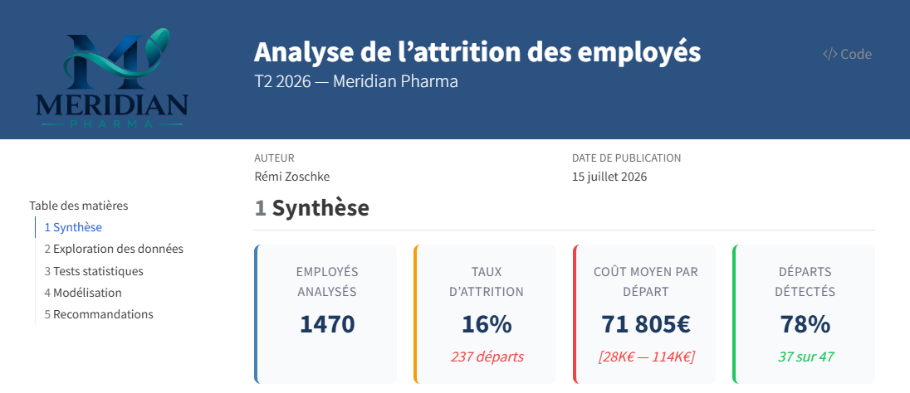

# 📊 Analyse de l'attrition des employés — Meridian Pharma

Rapport Quarto interactif qui identifie les facteurs de départ, prédit les employés à risque avec 78% de recall et chiffre le coût de l'attrition.


## 📋 Description

**Problème résolu :** Avec un taux d'attrition de 16%, Meridian Pharma perd chaque année des talents clés, générant un coût estimé entre 6.8M€ et 27.2M€.

**Solution apportée :** Un rapport analytique complet identifiant les facteurs de départ, prédisant les employés à risque et proposant des actions de rétention ciblées.

---

## 🎬 Rapport en ligne

🔗 **[Consulter le rapport interactif](https://remi-zoschke.github.io/employee-attrition-analysis/)**



---

## 📊 Résultats clés

- **Facteur n°1 de départ** : les heures supplémentaires (risque × 5.3)
- **Facteur n°1 de rétention** : l'implication dans le poste (risque ÷ 8)
- **Modèle prédictif** : détecte **78%** des départs (AUC = 0.82)
- **Coût moyen par départ** : **71 805€** [28K€ , 114K€]

---

## ⚡ Installation

```bash
git clone https://github.com/remi-zoschke/employee-attrition-analysis.git
cd employee-attrition-analysis
uv sync
make test
make render-html
```

> **Note Windows** : `make clean` nécessite Git Bash ou WSL. Sous PowerShell, utilisez `Remove-Item -Recurse -Force output\*, _freeze -ErrorAction SilentlyContinue`.

---

## 🔧 Structure du projet

```
├── report.qmd                 ← point d'entrée du rapport
├── _quarto.yml                ← configuration Quarto
├── pyproject.toml             ← dépendances Python (uv)
├── uv.lock                    ← versions verrouillées
├── Makefile                   ← commandes (render, test, lint)
├── assets/
│   └── logo.png               ← logo Meridian Pharma
├── data/
│   ├── raw/                   ← dataset IBM HR brut (CSV)
│   └── processed/             ← dataset nettoyé (Parquet)
├── scripts/
│   └── prepare_data.py        ← génération du parquet
├── sections/
│   ├── _executive-summary.qmd ← KPIs et synthèse
│   ├── _data-exploratory.qmd  ← exploration des données
│   ├── _analysis.qmd          ← tests stats + modélisation
│   └── _recommendations.qmd   ← personas et actions
├── src/
│   ├── analysis.py            ← tests stats et modèles
│   ├── charts.py              ← graphiques Plotly
│   ├── tables.py              ← tableaux Great Tables
│   ├── data_loader.py         ← chargement et nettoyage
│   └── config.py              ← paramètres du projet
├── styles/
│   └── theme.scss             ← thème visuel SCSS
└── tests/
    └── test_data.py           ← tests unitaires (7/7)
```

---

## 📈 Méthodologie

| Étape | Méthode | Résultat |
|---|---|---|
| Exploration | 5 graphiques Plotly | 16% d'attrition, surreprésentation des jeunes et bas salaires |
| Tests statistiques | t-test, χ², ANOVA | 17 variables significatives → 12 retenues après multicolinéarité |
| Modèle explicatif | Régression logistique (statsmodels) | Odds ratios : heures sup ×5.3, implication ÷8 |
| Modèle prédictif | Régression logistique (sklearn) | AUC = 0.82, recall = 78% |
| Interprétabilité | SHAP | Confirmation des facteurs clés |

---

## 💰 Impact Business

**Sans action** : 16% d'attrition, 237 départs, coût estimé entre **6.8M€ et 27.2M€** par an

**Avec le modèle** : détection de 78% des départs à risque, actions de rétention ciblées sur les profils critiques

**Levier principal** : la réduction des heures supplémentaires seule diminuerait le risque d'un facteur 5

---

## 🛠️ Stack technique


---

## 🚀 Améliorations prévues

- [ ] Thème SCSS personnalisé
- [ ] Export PDF embarqué
- [ ] Table des profils à risque top 10
- [ ] Estimation du ROI des actions de rétention

---

## 💡 Leçons apprises

- **SHAP vs régression** : les deux approches ne classent pas les facteurs dans le même ordre, croiser les méthodes évite de sur-interpréter un seul modèle
- **Multicolinéarité** : 17 variables significatives en bivarié, seulement 12 exploitables après vérification des corrélations entre prédicteurs
- **Données déséquilibrées** : 16% d'attrition seulement, le recall compte plus que l'accuracy pour détecter les départs réels

---

## 👤 Contact

**Rémi Zoschke** — Data Analyst

[](https://www.linkedin.com/in/remi-zoschke/)
[](mailto:zoschke.remi@gmail.com)

---

⭐ **Ce projet vous a plu ?** N'hésitez pas à laisser une étoile !
